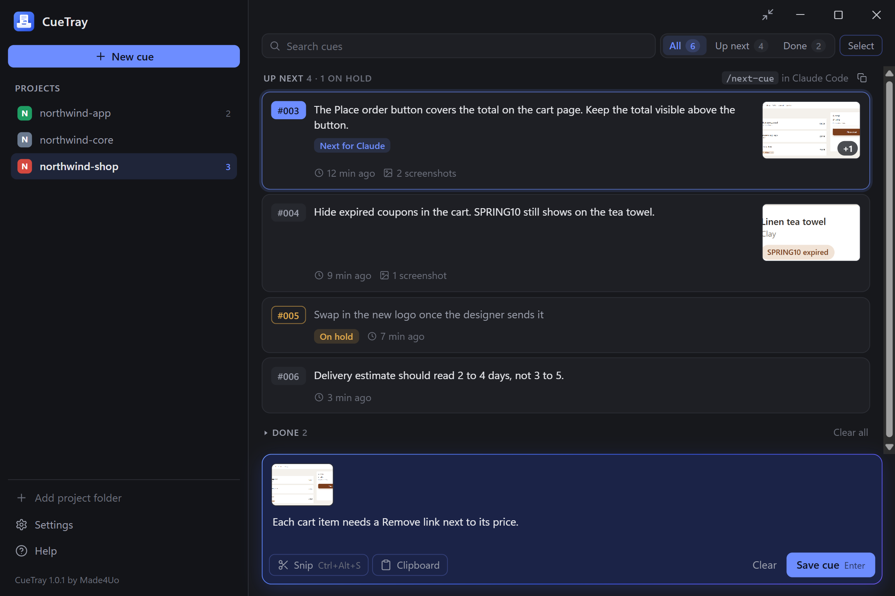
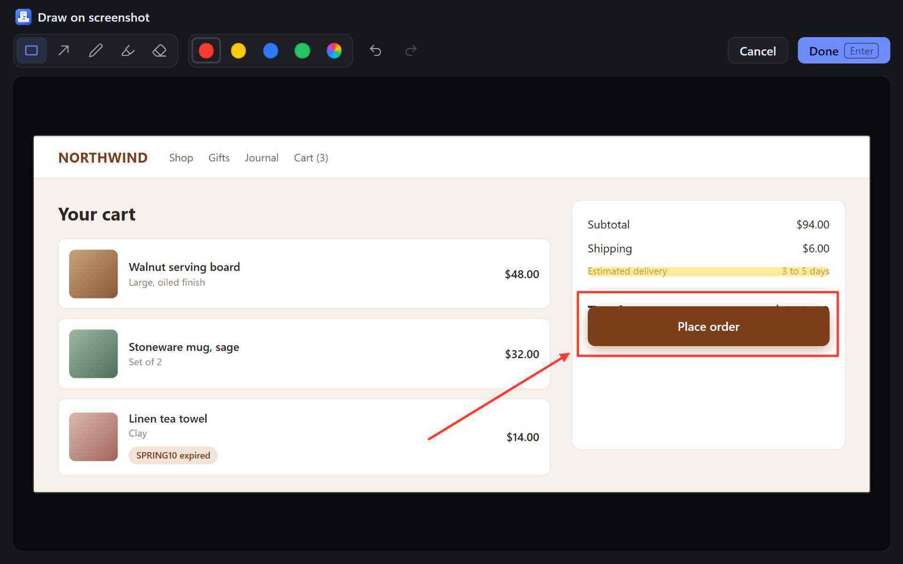

# CueTray

Snip a screenshot, write what you want done, and queue it as a numbered cue in your project.
When your AI coding assistant is free, `/next-cue` hands it the next cue, screenshots included.
For Claude Code, Codex and Gemini CLI, on Windows 10 and 11.

**[Download for Windows](https://cuetray.com/download)** · [Guide](https://cuetray.com/guide) · [cuetray.com](https://cuetray.com)

## How it works

1. While your assistant is busy, press <kbd>Ctrl</kbd>+<kbd>Alt</kbd>+<kbd>S</kbd> anywhere in Windows and drag around what you mean. Mark it up if you like: box, arrow, pen or highlighter.
2. Type what should change and press <kbd>Enter</kbd>. The message and the screenshot are saved together as a numbered cue, like #004, in the project they belong to.
3. When your assistant is free, run `/next-cue`. It takes the next cue in line, says which one it took, opens the screenshots and does the task. One cue per run, in the order you set.

| Claude Code, Gemini CLI | Codex | What it does |
| --- | --- | --- |
| `/next-cue` | `$next-cue` | Takes the first cue in line that isn't on hold |
| `/next-cue 4` | `$next-cue 4` | Takes cue #004, even if it's on hold |
| `/next-cue list` | `$next-cue list` | Shows what's waiting and what's on hold, and starts nothing |

The command is added to each tool from CueTray's settings: click **Install** next to the tool.

## Other AI tools

For ChatGPT, Claude, Gemini, Cursor, Copilot and the rest: click **Copy** on a cue, click in the chat,
and press <kbd>Ctrl</kbd>+<kbd>Alt</kbd>+<kbd>P</kbd>. CueTray pastes the message, then the
screenshot, as two pastes, because most chat apps keep only one thing from a single paste.

In a terminal, the same shortcut pastes the message with the screenshots' file paths under it, as
text, so a command-line assistant can open them.

## Features

- Snip any part of any monitor, and draw on it in colors you choose
- Each cue keeps its number for good, so "#004" always means the same cue
- Drag cues into any order, put them on hold, edit, search by words or number, mark done, restore
- One line of cues per project, suggested from the folders open in VS Code, Cursor, Windsurf or VSCodium, and from Claude Code and Codex history
- A small window, or a wide one with a sidebar of your projects and how many cues wait in each
- Light and dark, following Windows

## Shortcuts

| Shortcut | What it does |
| --- | --- |
| <kbd>Ctrl</kbd>+<kbd>Alt</kbd>+<kbd>S</kbd> | Snip a new cue |
| <kbd>Ctrl</kbd>+<kbd>Alt</kbd>+<kbd>C</kbd> | Show or hide the CueTray window |
| <kbd>Ctrl</kbd>+<kbd>Alt</kbd>+<kbd>P</kbd> | Paste the last copied cue into the window in front |
| <kbd>Ctrl</kbd>+<kbd>Alt</kbd>+<kbd>Shift</kbd>+<kbd>P</kbd> | The same, as text with the screenshots' file paths |

Each one can be changed in settings.

## Where cues are kept

Cues are plain files in a `.cuetray` folder inside your project, kept out of your git commits.
Each cue holds your message, exactly as you typed it, and its screenshots. Cues on hold and
finished cues are kept in their own folders next to the waiting ones.

There is no account and no cloud sync. CueTray goes online for three things only: update checks
to this repository's releases, a refund check once a day while a license key is entered, and
anonymous usage counts if you say yes. It never sends your cues, screenshots or project names.
Details: [cuetray.com/privacy](https://cuetray.com/privacy).

## Install and updates

- Windows 10 or 11, 64-bit. CueTray installs for your Windows user only, with no administrator prompt.
- Download from [cuetray.com/download](https://cuetray.com/download), or `CueTray-Setup-<version>.exe` from the [latest release](https://github.com/Made4Uo/cuetray/releases/latest) here. The "Source code" files GitHub adds to every release aren't the app.
- The installer is signed by Made4Uo LLC. Because CueTray is new, Windows may show "Windows protected your PC": click **More info**, check that the publisher is Made4Uo LLC, then click **Run anyway**.
- CueTray updates itself from the releases here and installs a new version the next time it restarts. It accepts only updates signed by Made4Uo LLC.

## Price

Free for 14 days with every feature, no card and no account. After that, $14.99 once, no
subscription, one license per device. Cues you saved keep working after the trial. Refunds within
14 days of buying. [Buy a license](https://cuetray.com/buy).

## Help

- [The guide](https://cuetray.com/guide) covers every feature and the common problems.
- Feedback or a problem: in CueTray, **Settings**, **About**, **Send feedback**, or write to
  [info@made4uo.com](mailto:info@made4uo.com).

This repository holds CueTray's installers and release notes. The app's source code isn't
published here.

By Mary Hill, [Made4Uo](https://made4uo.com).
